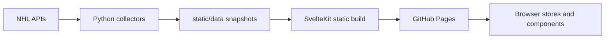

# Architecture

[Documentation index](README.md)

## Build and runtime

The project uses Svelte 5 and SvelteKit 2 with the static adapter. [package.json](../package.json) defines dependencies and commands; [svelte.config.js](../svelte.config.js) defines `build/` output and the `200.html` fallback. The root [layout configuration](../src/routes/+layout.js) enables prerendering and trailing slashes.

`+page.server.js` and `+layout.server.js` modules run during prerendering. Their existence does not mean GitHub Pages hosts a running SvelteKit server. Local development does run SvelteKit's development server.

The root [layout](../src/routes/+layout.svelte) owns game-data initialization and timer cleanup. The results path is:

## Dashboard data lifecycle

[gameData.js](../src/lib/stores/gameData.js) owns the selected date, games, players, loading/error state and date indexes. Its default follows yesterday in the visitor's local calendar until the visitor chooses another date. The root layout starts minute-based refreshes and visibility recovery.

[dataService.js](../src/lib/services/dataService.js) loads games and players from one dated snapshot, so their scores stay consistent. Failed background refreshes keep the last good results and expose a separate warning. A response for a previous selection must not overwrite a newer selected date.

The homepage keeps the selected date in the URL. [PlayerList](../src/lib/components/game/PlayerList.svelte) selects actual participants, groups positions and renders [PlayerCard](../src/lib/components/game/PlayerCard.svelte). Before today's games start, the empty state can feature one completed game from yesterday alongside future Finnish-team games and eligible news. See [Player data](PLAYER_DATA.md).

## Public sections

The primary navigation currently exposes results, standings, teams and the points leaderboard. Player profiles, weekly editorial recaps and championship routes also exist.

[features.js](../src/lib/config/features.js) controls temporarily disabled sections. Transfers and the prospects/drafts/scouting group are currently disabled. Their implementations remain in the repository. Keep navigation, route guards and sitemap behavior consistent when changing availability; do not infer public availability just from a route directory.

## Other boundaries

| Concern | Implementation |
| --- | --- |
| Static season-stat loading | [playerStats.js](../src/lib/server/playerStats.js) |
| Official standings adapter and refresh | [standingsService.js](../src/lib/services/standingsService.js) |
| News index caching and selection | [dailyNewsService.js](../src/lib/services/dailyNewsService.js), [dailyNews.js](../src/lib/utils/dailyNews.js) |
| Safe editorial HTML | [safeMarkdown.js](../src/lib/utils/safeMarkdown.js) |
| Shared UI surfaces and controls | [design-system.css](../src/lib/styles/design-system.css) |

When adding local data URLs, include SvelteKit's base path. Published endpoints and files must exist in the static build; a development-only server endpoint is not automatically available on GitHub Pages.
